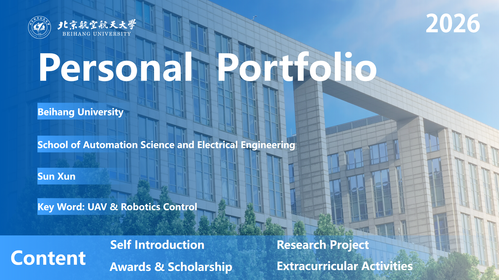
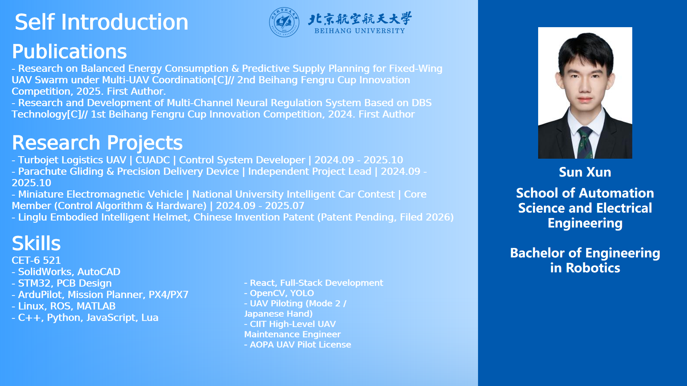
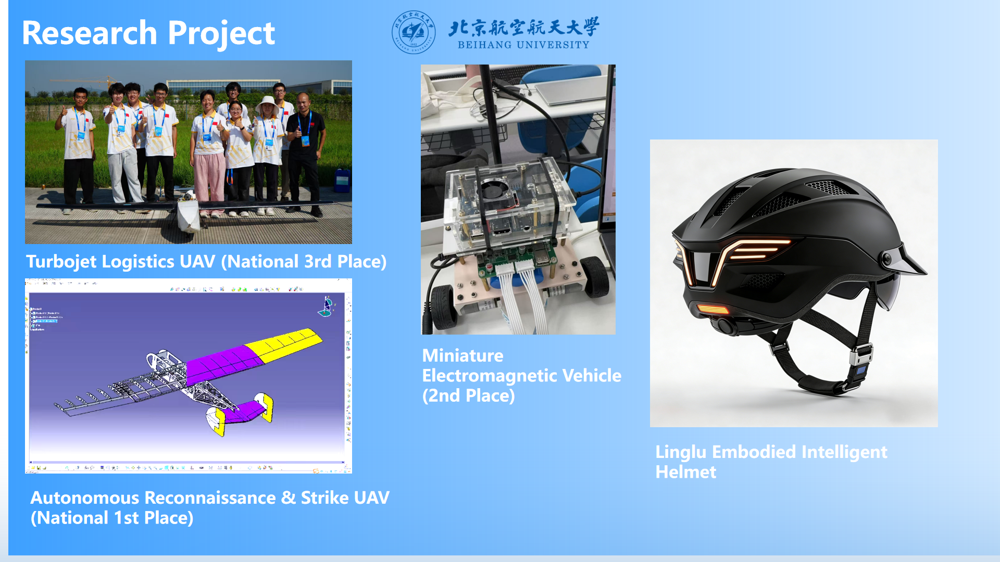
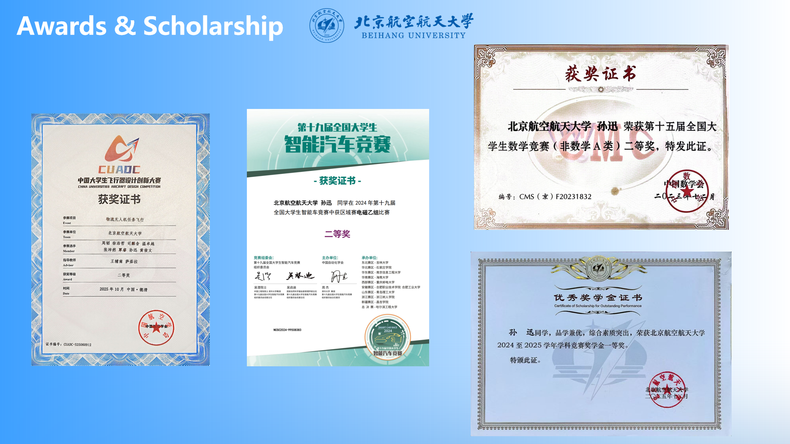
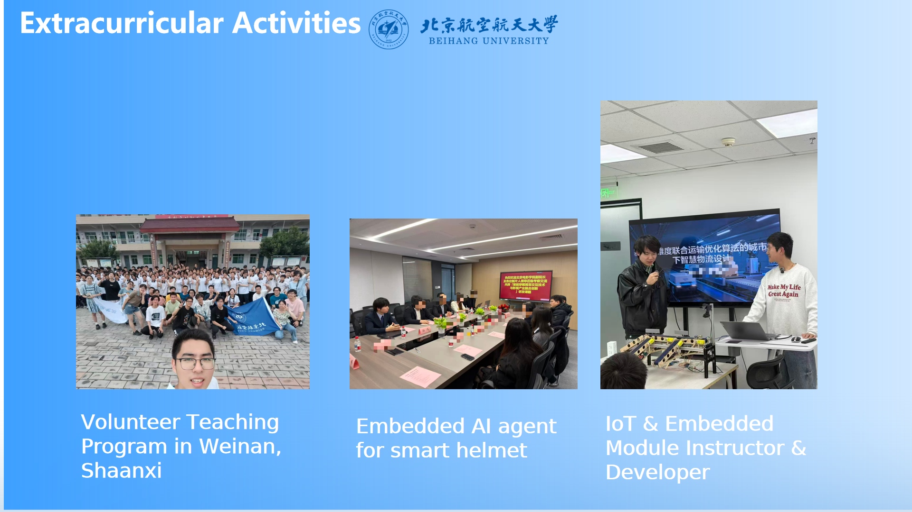

# Personal Portfolio — Sun Xun

**Beihang University** · School of Automation Science and Electrical Engineering
**Key Word:** UAV & Robotics Control · 2026

  
  
  

## Contents

- [Self Introduction](#self-introduction)
- [Research Project](#research-project)
- [Awards & Scholarship](#awards--scholarship)
- [Extracurricular Activities](#extracurricular-activities)

---

## Self Introduction

**Sun Xun** — Bachelor of Engineering in Robotics, School of Automation Science and Electrical Engineering, Beihang University.

### Publications

- *Research on Balanced Energy Consumption & Predictive Supply Planning for Fixed-Wing UAV Swarm under Multi-UAV Coordination* [C]// 2nd Beihang Fengru Cup Innovation Competition, 2025. **First Author**.
- *Research and Development of Multi-Channel Neural Regulation System Based on DBS Technology* [C]// 1st Beihang Fengru Cup Innovation Competition, 2024. **First Author**.

### Research Projects

| Project | Role | Duration |
|---|---|---|
| **Turbojet Logistics UAV** — CUADC | Control System Developer | 2024.09 – 2025.10 |
| **Parachute Gliding & Precision Delivery Device** | Independent Project Lead | 2024.09 – 2025.10 |
| **Miniature Electromagnetic Vehicle** — National University Intelligent Car Contest | Core Member (Control Algorithm & Hardware) | 2024.09 – 2025.07 |
| **Linglu Embodied Intelligent Helmet** | Chinese Invention Patent (Patent Pending, Filed 2026) | — |

### Skills

| Category | Skills |
|---|---|
| Language | C++, Python, JavaScript, Lua |
| Software | SolidWorks, AutoCAD, Linux, ROS, MATLAB |
| Embedded | STM32, PCB Design |
| Autopilot | ArduPilot, Mission Planner, PX4/PX7 |
| Vision | OpenCV, YOLO |
| Web | React, Full-Stack Development |
| UAV Operation | UAV Piloting (Mode 2 / Japanese Hand), AOPA UAV Pilot License, CIT High-Level UAV Maintenance Engineer |
| English | CET-6: 521 |

Original slide

---

## Research Project

- **Turbojet Logistics UAV** (National 3rd Place)
- **Autonomous Reconnaissance & Strike UAV** (National 1st Place)
- **Miniature Electromagnetic Vehicle** (2nd Place)
- **Linglu Embodied Intelligent Helmet**

---

## Awards & Scholarship

| Award | Level | Year |
|---|---|---|
| China Universities Aircraft Design Competition (CUADC) — *Logistics UAV Mission Flight* | National 2nd Prize | 2025.10 |
| 19th National University Student Intelligent Car Contest — Regional Final, Electromagnetic Group B (电磁乙组) | 2nd Prize | 2024 |
| 15th National Mathematics Competition (Non-Mathematics, Group A) | 2nd Prize | 2023 |
| Beihang University Scholarship for Outstanding Performance — Academic Competition Scholarship | 1st Prize | 2024 – 2025 |

---

## Extracurricular Activities

- **Volunteer Teaching Program** in Weinan, Shaanxi
- **Embedded AI Agent** for smart helmet
- **IoT & Embedded Module Instructor & Developer**

---

> Converted from the original PDF portfolio (5 slides, 1920×1080). Original slide renders are kept in [`assets/`](assets/).
