# 2025 中国大学生飞行器设计创新大赛 — 固定翼无人机侦察与打击 · 设计报告

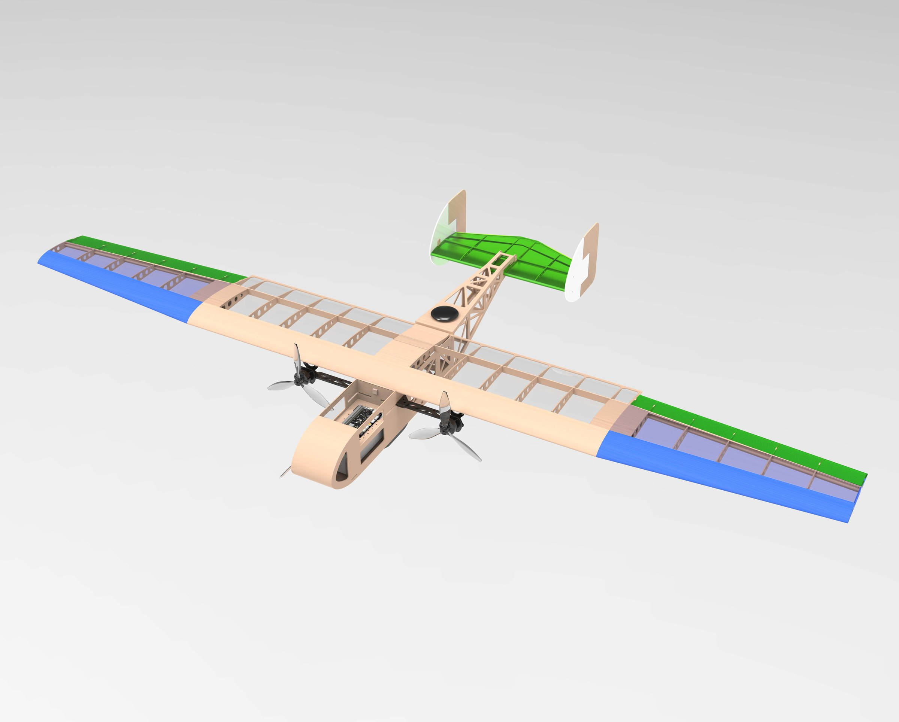

| | |
|---|---|
| **参赛项目** | 固定翼无人机侦查与打击 |
| **参赛单位** | 北京航空航天大学 |
| **日期** | 2025 年 9 月 20 日 |

## 摘要

本设计报告围绕 2025 CUADC "固定翼无人机侦察与打击"竞赛任务，提出并实现了一套轻量化、高自主、强鲁棒的无人机系统方案。系统以 **Jetson Orin NX 16GB** 为核心计算平台，集成 **YOLO11** 视觉模型，通过图像识别、价值分类，实现对军事目标的精确判断；通过旋转框检测、图像转正、数字识别三步策略，实现对数字靶标的精准识别；在飞控层面，基于 pymavlink 协议自主编写 "**BLink**" 以增强可调整性，用 Lua 特技脚本，实现 35° 快速爬升与半滚倒转等特技动作，以缩短任务用时；在结构层面，采用 N11 翼型与全动平尾，配合可折叠机翼与模块化机身，兼顾便携性与气动效率。通过智能生成特技侦察打击航点与风偏补偿打击航线，结合地面端仿真验证与实飞测试，本无人机最终可实现**数字识别准确率 91.8%、任务完成时间小于 100 秒、打击落点误差小于 1.5 米**，验证了方案的可行性与先进性。

**关键词**：固定翼无人机；自主识别；YOLO11；智能航路规划；风偏补偿航线；Lua 特技脚本

---

## 引言

随着无人系统在军事侦察、灾害救援与边境巡逻等场景中的广泛应用，小型固定翼无人机在复杂环境下的自主识别与精准打击技术已成为研究热点。当前主流方案多依赖地面站遥控或预编程航点，存在任务响应慢、识别精度低、抗干扰能力弱等问题，难以满足"发现即打击"的实战需求[1]。

本研究以大赛"固定翼无人机侦察与打击"任务为背景，针对目标识别鲁棒性不足、任务流程人工干预多、打击精度受风偏影响大等痛点，提出了一套端到端自主化解决方案。在视觉识别层面，创新性地采用 YOLO11-OBB 旋转框检测结合图像转正策略，解决了靶标角度偏转的问题；在飞控层面，基于 pymavlink 协议自主编写 "BLink" Python 库，兼容高版本 Python 环境，显著提升数据传输稳定性，并通过 Lua 脚本实现特技飞行动作，优化爬升与转向效率；在结构设计层面，通过 N11 翼型与可折叠机翼设计，在任务箱尺寸限制下实现了**翼展 1.74 m、空重 2.4 kg** 的轻量化平台，兼顾便携性与气动性能；在航线规划层面，提出风偏补偿打击算法，通过四阶龙格-库塔法模拟空投轨迹，动态修正航点偏移，确保打击精度。

本设计的创新点在于将视觉检测多流并行处理和风偏补偿模型引入小型无人机侦察打击任务，并通过实飞验证了其工程可行性。研究成果不仅为大赛提供了可靠的技术方案，也为未来小型无人机在复杂环境下的自主作战提供了可复用的设计范式。

## 1 任务概述与创新设计

### 1.1 规则分析与任务流程

本项目要求飞机能够实现两个任务，即对目标区 4 个天井的侦察并识别靶标数字或军事目标，对"中位数"或价值最高的军事目标所在的天井实施模拟打击任务，鼓励全程自主化，以自动起降、正确识别、精准打击和任务用时短为优。本任务可以分为以下 7 个子任务来进行：

*图 1 总任务流程图（Figure 1 Overall Task Flow Chart）*

可分为机载程序设计、飞控程序设计、任务航线设计、飞行平台设计四个部分实现。

### 1.2 设计需求与实现方法

为充分满足任务需要，本设计在四个设计部分的细节进行了创新，最终实现了飞机全任务过程的自主化，且经过测试具有较高效率和可靠性。

*表 1 设计需求与实现方法（Table 1 Design Requirements and Implementation Methods）*

| 设计需求 | 实现方法 |
|---|---|
| 自动起降 | 手抛式自动起飞，滑橇式自动降落 |
| 易于携带、快速装机 | 飞机部件易拆卸，可折叠 |
| 需容纳各类机载设备 | 增大机身空间，优化设备布置 |
| 视野广阔、搜索准确 | 选择大画幅短焦无畸变镜头 |
| 搜索快速、覆盖全面 | 依据摄像头和飞机性能规划航线 |
| 侦查实时、识别正确 | 搭载多级神经网络系统 |
| 精准打击 | 程序自主规划投弹航线 |

## 2 机载程序设计

### 2.1 整体流程

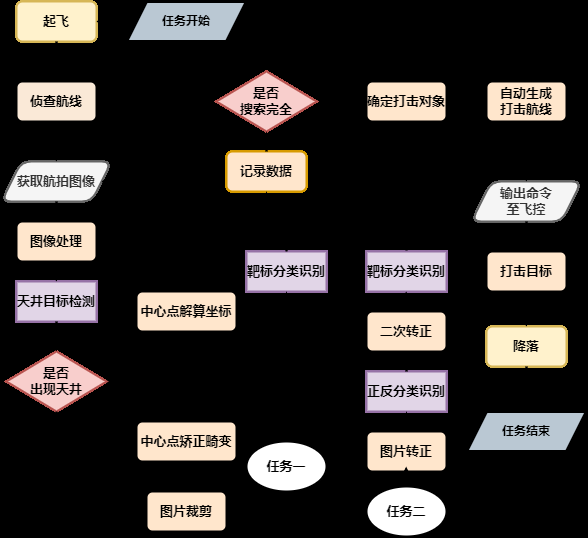

*图 2 程序流程图（Figure 2 Program Flowchart）*

### 2.2 硬件设备

机载设备承担着系统的"认知"与"决策"核心功能，需完成航拍图像的获取与处理、打击目标的识别与锁定，以及投弹航线的自主规划。为满足高性能侦察与识别的需求，选择 **Jetson Orin NX 16GB** 作为机载计算平台，负责目标检测与推理任务。该平台配备 8 核 CPU、16GB 内存，以及具备 1024 NVIDIA® CUDA® cores 和 32 Tensor cores 的 GPU，提供卓越的图像处理与数据处理能力[1]。

为兼顾大画幅覆盖与高分辨率成像的要求，摄像头采用全局快门，搭配 OmniVision OX05B1S 芯片及 6 mm 焦距镜头的方案获取航拍图像。经实测验证，该组合可稳定输出 **2592×1944 分辨率、50 帧/秒**的视频流。

### 2.3 模型介绍

对于图像检测任务，YOLO11 是 YOLO 系列最新的部署成熟成果，对比之前最泛用的 YOLOv8 有着许多显著优势，如：增强的特征提取、针对效率和速度进行了优化、用更少的参数提高精度、跨环境的适应性、广泛的支持任务等[3]。实验测试了不同模型在本项目任务数据集上的表现，最终选择 YOLO11 作为主要的任务模型。

*表 2 不同 YOLO 模型在本任务的性能测试（Table 2 Performance Test Results of Different YOLO Models in This Task）*

| 模型 | P% | R% | mAP@0.5 | mAP@0.95 | Params (M) | GFLOPS | FPS |
|---|---|---|---|---|---|---|---|
| YOLOv3 | 79.2 | 71.5 | 0.464 | 0.857 | 6.5 | 16.6 | 110 |
| YOLOv5n | 80.6 | 73.2 | 0.457 | 0.876 | 7.0 | 19.0 | 147 |
| YOLOv8n | 79.2 | 72.8 | 0.469 | 0.868 | 3.2 | 18.9 | 166 |
| YOLO11n | 82.2 | 74.6 | 0.473 | 0.886 | 11.2 | 20.4 | 113 |

### 2.4 任务二——中位数靶标打击

#### 2.4.1 程序实现

本次比赛共有两项任务，具体的识别策略相似，下文先以复杂度更高的任务二——中位数靶标打击介绍我们的程序实现逻辑。任务二基于在机载电脑上部署的 YOLO11-OBB、YOLO11-CLS 和 YOLO11 三种模型，制定了三步的检测方案。

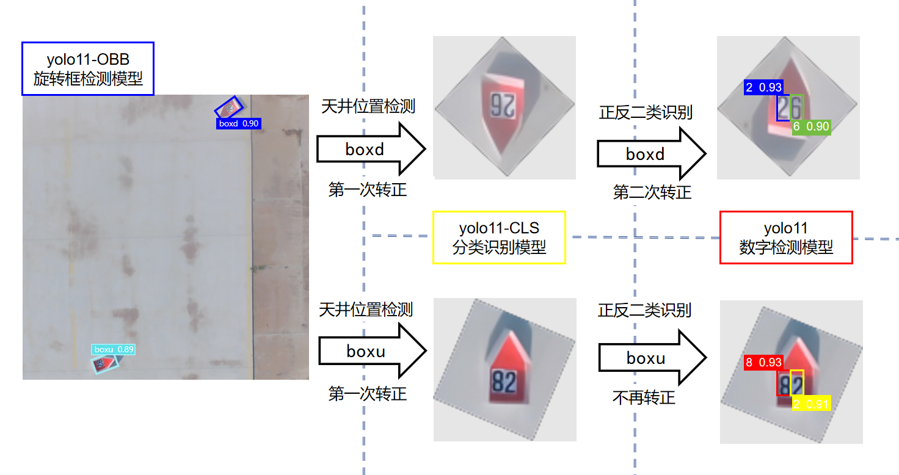

*图 3 任务二检测的多层次 YOLO 推理过程（Figure 3 The multi-level YOLO inference process for Task 2 detection）*

**（1）天井位置检测**

采用 YOLO11-OBB 旋转框检测模型，搜索全图找到靶标位置。相比于直框检测方法，旋转框能有效去除背景影响，极大地提高检测的精度。

为了确定天井在图片中的正反，设计了 `boxu` 和 `boxd` 的二分类方式，分别表示"上短边为底"和"下短边为底"。在不断尝试和调整训练参数后，实现了二者的有效区分和识别，并使模型能够正确指示天井五边形锐角的朝向。根据这一信息可以获得天井初步转正所需的旋转角度。

**（2）天井转正**

按照第一步天井位置旋转框检测的结果，将获得的图片先裁剪为 128×128，再按照检测得到的角度旋转过后，得到尖角朝上或朝下的结果。对于初步旋转后的图片，使用 YOLO11-CLS 分类模型，进行以 `boxu` 和 `boxd` 为类别的二分类，再依据分类结果将天井转正为尖角朝上。采用深度学习方法替代传统方法（如对天井进行颜色筛选并分割转正），提升对光照和遮挡的鲁棒性。

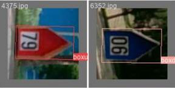

*图 4 分类示意图（Figure 4 Classification Diagram）*

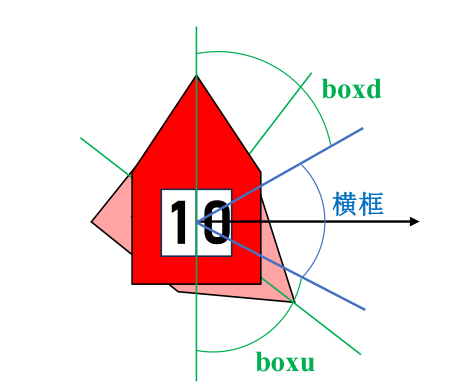

*图 5 横框检测结果（Figure 5 Horizontal Box Detection Results）*

**（3）数字检测**

通过上述步骤，获得了转正后的天井图片，此时靶标数字也随天井一同正置，因此理论上此时直框检测成为综合精确度和检测速度的最佳选择。

对于转正后的 128×128 尺寸的图片进行 YOLO11 直框检测，分别获得靶标数字的十位数和个位数，再通过其相对位置得到最终的数字检测结果。

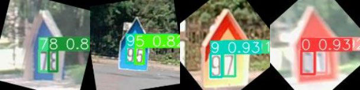

*图 6 数字检测结果（Figure 6 Digital Detection Results）*

#### 2.4.2 验证测试

在地面端对多段真实航拍视频进行测试，统计不同数字的检测情况和识别正确率，最终实验结果如表 3。

*表 3 本地部署实验结果（Table 3 Results of Local Deployment Experiment）*

| 数字 | 36 | 17 | 56 | 69 | 45 | 20 | 08 |
|---|---|---|---|---|---|---|---|
| OBB 正确率 | 95.20% | 98.10% | 100% | 95.10% | 100% | 100% | 98.10% |
| CLS 正确率 | 100% | 100% | 100% | 100% | 100% | 100% | 100% |
| 数字正确率 | 92.90% | 90.40% | 89.80% | 87.10% | 94.50% | 93.00% | 90.40% |

| 指标 | 数值 |
|---|---|
| OBB 平均耗时 | 24 ms |
| CLS 平均耗时 | 8 ms |
| 数字检测平均耗时 | 10 ms |
| **总正确率** | **91.8%** |
| **总帧率** | **26 FPS** |

由表 3 显示，在准确度方面，程序基本不发生误检，且能在单次搜索中迅速得到预期的数字检测结果；在检测速度方面，通过视频读取、图像处理、图像检测、坐标解算等过程的并行运算，再对视频流解码加以优化[4]，帧率能够达到 25 帧。

### 2.5 任务一——最高价值军事目标打击

任务一相对于任务二在识别难度上较低，因而可采用简化的两步方案：

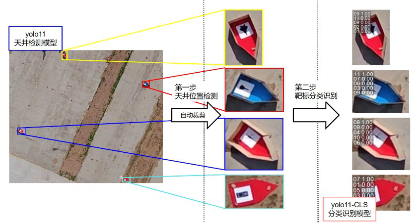

*图 7 任务一检测的多层次 YOLO 推理过程（Figure 7 Multi-level YOLO Inference Process for Task One Detection）*

第一步使用 YOLO11 模型搜索全图定位目标，模型尺寸 640×640，同时保证高精度与效率；第二步基于第一步检测后裁剪出的图像，应用 YOLO11-CLS 模型对目标价值编号进行分类检测，并筛选出最高价值目标。

### 2.6 模型优化与创新点

**① CUDA 多流并发处理**：尽可能利用机载电脑 Jetson 的多核优势，GPU 多流并行提高 YOLO 模型的运行推理效率[4]。

*表 4 Jetson 上使用 CUDA 多流并发的性能对比（Table 4 Performance comparison chart of CUDA multi-stream concurrency on Jetson）*

| 性能指标 | 单流模式 | 双流并发 | 四流并发 | 提升幅度 |
|---|---|---|---|---|
| 推理帧率 (FPS) | 5 fps | 11 fps | 24 fps | +158% |
| 端到端延迟 | 32 ms | 19 ms | 12 ms | −62.5% |
| 目标识别精度 | 94.2% | 95.1% | 96.3% | +2.1% |
| 多目标处理能力 | 8 个目标/帧 | 14 个目标/帧 | 22 个目标/帧 | +175% |

**② TensorRT 部署加速 + FP16 半精度量化**：使用 TensorRT 的 engine 格式在 Jetson 上部署加速，并使用 FP16 半精度量化处理模型，在保证精度的同时将模型的推理效率尽可能增大。

*表 5 Ultralytics 在 Jetson Orin NX 16GB 上部署的不同格式 YOLO 模型（Table 5 Different formats of YOLO models deployed by Ultralytics on Jetson Orin NX 16GB）*

| 格式 | 磁盘大小 (MB) | mAP50-95 | 推理时间 (ms/img) |
|---|---|---|---|
| PyTorch 插件 | 5.4 | 0.5101 | 12.90 |
| (FP16) TensorRT | 8.1 | 0.5085 | **4.73** |
| (FP32) TensorRT | 11.8 | 0.5081 | 7.94 |
| (INT8) TensorRT | 5.4 | 0.4786 | 3.90 |

## 3 飞控程序设计

### 3.1 飞控特技脚本

在传统的自动起飞航点控制中，飞机往往在靶标上空无法达到预定侦察高度。为解决这一问题，本次设计引入特技脚本，使飞机在起飞后直接执行 **35° 爬升特技**，实现快速爬升至侦察高度[6]；同时，在侦察完成后的打击阶段，采用**半滚倒转特技**完成快速降高与转向的一体化操作，替代传统的"长距离转弯 + 缓慢降高"模式，大幅提升对地打击效率，缩短敌军反制与躲避的窗口。

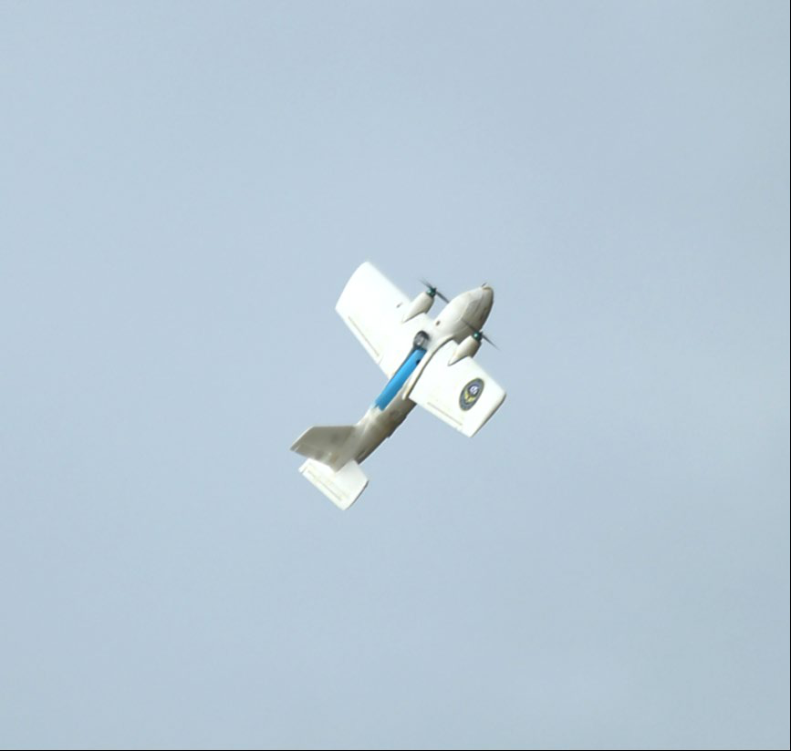

*图 8 35° 大坡度爬升特技飞行演示（Figure 8 35° Steep Climb Aerobatic Demonstration）*

### 3.2 Mavlink 连接模块 BLink 的设计与实现

鉴于 dronekit 库长期缺乏维护，存在与新版 Mavlink 协议及高版本 Python 环境的兼容性问题，我们基于 pymavlink 重构了高可靠性通信模块 "**BLink**"，实现了连接管理、消息收发、参数配置与任务上传等核心功能，为飞控系统提供了稳定、可定制的底层通信支持。

BLink 模块支持初始化时一步完成飞控连接，自动同步心跳包并确认链路状态，实时获取飞控参数与飞机姿态信息。其高效参数读取机制可按需请求关键数据，显著降低通信冗余与带宽占用。同时，BLink 支持消息实时发送与频率自定义，可将飞行状态、识别结果等信息实时回传至地面站，为系统监控与调试提供可靠基础。

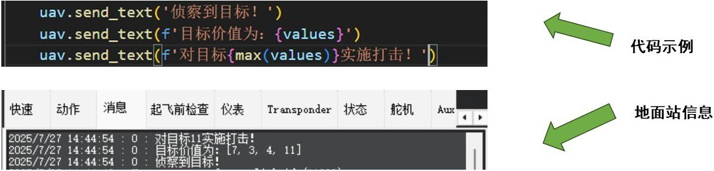

*图 9 飞行中向地面站回传信息示意图（Figure 9 Schematic Diagram of Information Transmission to the Ground Station During Flight）*

## 4 任务航线设计

### 4.1 智能航路规划——主动规划特技航点

在上文提到的通信架构的支撑下，机载电脑具备了对飞行状态的全局感知能力，可依据实际任务需求（如快速爬升、高效降高转向等）动态规划并插入特技航点，实现了"感知-决策-执行-调整"的闭环自主控制。系统基于实时获取的飞机姿态、高度、空速及任务阶段信息，智能判断是否插入特技航点，并自动选择最优特技类型与参数。

例如，起飞后若当前高度与目标高度差超过 30 米，系统自动插入 35° 大坡度爬升特技，并动态计算爬升半径与速度，确保飞机以最大性能快速抵达侦察高度。在进入打击阶段，系统依据高度差、目标方位、空速及空域条件实时判定，在满足安全边际时自动添加半滚倒转特技航点，替代传统缓慢降高与大半径转弯，实现快速俯冲、降高与转向一体化操作，显著压缩航线时间，降低被探测风险。

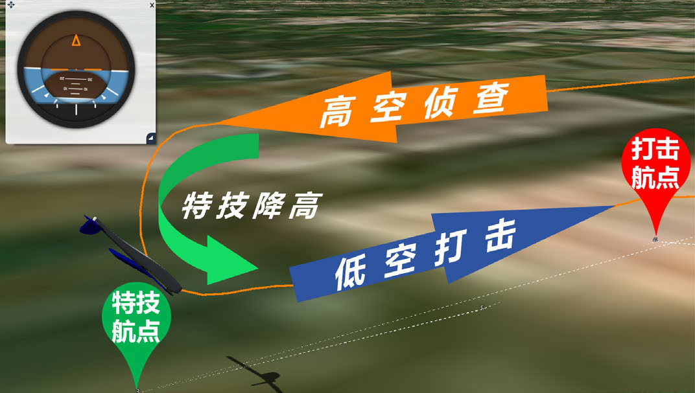

*图 10 半滚倒转特技示意图（日志回放）（Figure 10 Half Roll Backward Aerobatic Maneuver (Log Playback)）*

每一个自动生成的特技航点均经过多层次合法性检查，包括动力学可行性、空域冲突、能量状态（高度-空速匹配性）及应急策略模拟。系统基于飞机实时状态与性能包线，验证航点可执行性，确保动作不超出俯仰角、过载或失速边界，在发挥最大性能的同时保障安全。此外，系统可在航点执行过程中根据实际飞行状态进行在线优化。例如，在半滚倒转切入前若检测到风速突变或高度偏差，将实时重新计算滚转时机与退出半径，确保精准对准攻击航路。

经实际航线验证，该系统的应用显著提升了任务执行效率，实验结果如表 6。与传统 APM 航点控制方法相比，全程飞行用时平均减少约 35%，在打击阶段，因半滚倒转机动带来的高效降高与精准转向能力，打击响应时间缩短超过 50%，有效提升了任务成功率与系统生存性。

*表 6 使用特技航点飞行前后效果对比（Table 6 Comparison table of effects before and after using special flight points）*

| 性能指标 | 使用特技航点前 | 使用特技航点后 | 提升效果 |
|---|---|---|---|
| 全程飞行用时 | 103 s | 67 s | 平均减少约 35% |
| 打击响应时间 | 8.3 s | 4.1 s | 缩短超过 50% |

### 4.2 结合风力因素的综合航点规划

若有风时，需要考虑风的综合影响来规划航线，如图 11。风速 V，风向 φ（正北方向为 0，顺时针为正），初始方位角 θ，航向方向风速 u，垂直航向方向风速 v，将其进行正交分解，假定所遇到的风在航向方向无影响，在垂直于航向的方向产生了影响。为研究风对偏移的影响，我们建立了一个考虑空气阻力与风速的二维落体运动模型。利用四阶龙格-库塔法对运动微分方程进行了数值积分。结果显示，随着风速增大，瓶子的水平偏移显著增加：在风速为 6 m/s 时，偏移约为 1.35 米；风速为 12 m/s 时偏移接近 4 米，可见考虑风速是十分有必要的。

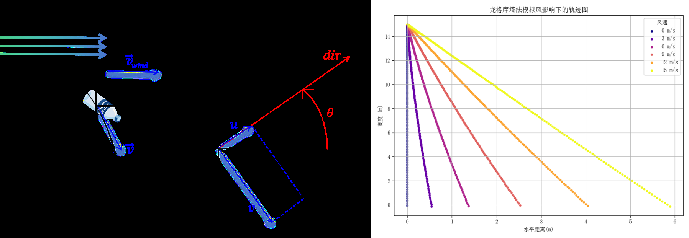

*图 11 风对任务执行产生的影响（Figure 11 The Impact of Wind on Task Execution）*

飞机将在原航线基础上进行航线的侧向平移，侧向距离由经验公式 **Δx = Khv²** 计算得到，航线图如图 12。

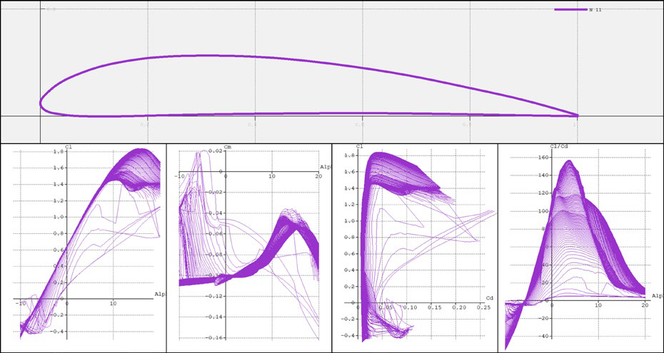

*图 12 侧向风影响下投水航线轨迹图（Figure 12 Trajectory Map of the Water Release Route under the Influence of Sideways Wind）*

## 5 飞行平台设计

### 5.1 机翼设计

#### 5.1.1 气动设计

飞机主翼为平直机翼，翼型为 **N11**，翼展 1.74 m，机翼面积 0.392 m²，展弦比为 8.643。N11 翼型底部近乎水平，可以更好地进行折叠以满足比赛需求。

平尾在矩形翼的基础上在后缘位置切除斜角以保证垂尾舵面的运动，同时为提高全机稳定性选用了反弯 NACA2412 翼型[7]，翼展 0.35 m，面积 0.05 m²，平尾尾容量 0.322，设计为全动平尾以弥补尾容量不足。

垂尾设计为双垂尾，平板翼型，面积 2×0.024 m²，与平尾用螺栓连接，垂尾尾容量 0.4，具有较高的横向静稳定性，满足面积需求的同时充分利用 990 mm×345 mm×235 mm 的箱子空间。

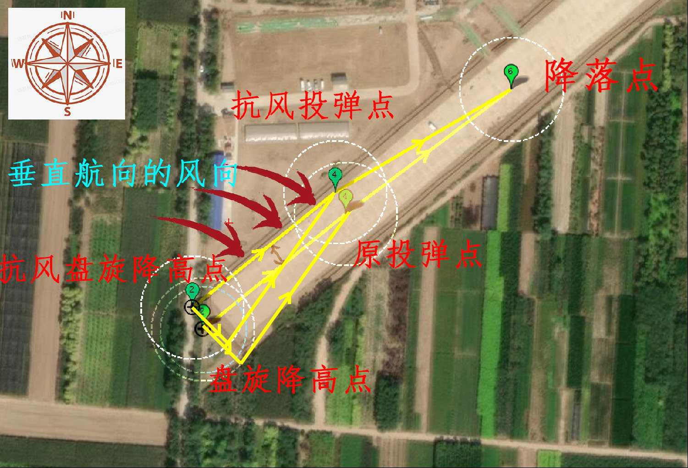

*图 13 主翼翼型及其相关气动系数（Figure 13 Main Wing Airfoil and Its Related Aerodynamic Coefficients）*

以下是使用 Xflr5 和 Fluent 软件获得的全机气动性能。

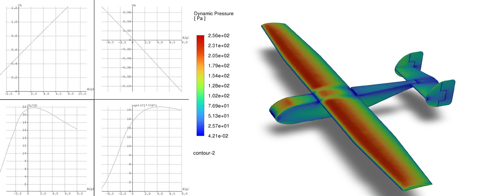

*图 14 Xflr5 和 Fluent 全机气动参数（Figure 14 Aerodynamic parameters in Fluent and Xflr5）*

#### 5.1.2 结构设计

机翼采用单梁结构，腹板式翼梁由桐木缘条与轻木腹板构成，机翼的 D 盒、翼肋等部分为轻木材质，重量较轻的同时具有较强的抗扭刚度。机翼折叠部分为闭室结构，下方由不锈钢铰链连接，上方由锁扣固定，外段机翼受力通过翼盒经由铰链传递至中段。

### 5.2 机身设计

机身长 0.84 m，宽 0.09 m，高 0.11 m，由层板制成，可放进 990 mm×345 mm×235 mm 的箱子中。机身主要承力结构为电机隔框与机翼连接隔框，由层板制成。

电机隔框与机身侧板、机身底板和电机架构成闭室，强度刚度较高，足以承受电机拉力和机翼升力。机翼连接隔框与机翼通过螺丝连接，承受机翼升力。

考虑到机身尾部主要承受尾翼所受的扭矩，模拟 W 形空间桁架结构，在保证扭转惯性矩足够高的同时进一步减小结构重量。

### 5.3 动力设计

#### 5.3.1 电机及螺旋桨

飞机使用 6S 3000 mAh 电池，重量 400 g，使用 2810 kv1100 电机，配合 7×5×3 桨叶。飞机经测试具有良好的加速性能，有助于缩短任务耗时。

#### 5.3.2 电机架

电机架共分为电机臂、挡板、盖板和电机座四部分，电机臂通过螺丝与上盖板相连接，可以折叠，挡板与上下盖板利用螺丝连接。

开展加载实验以验证电机架强度，电机架中心固定，两端挂重物模拟电机拉力，挂载 5 kg 重物保持 30 s，电机架未发生明显变形和破坏。电机最大拉力约为 2.5 kg，实验结果满足 2 倍的安全系数，满足强度需求。

## 6 设计制作流程与全机成本

### 6.1 设计制作流程

设计制作流程实现了程序设计与飞机设计制作的多路并行、节点重合，最大限度地利用了团队八人的时间，使得项目整体进度相较去年大幅加快，流程甘特图如图 15。

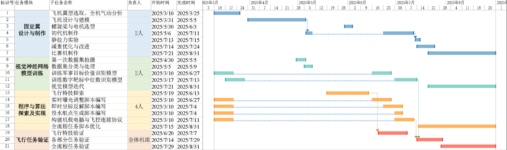

*图 15 设计制作流程甘特图（Figure 15 Gantt Chart of Design and Production Process）*

### 6.2 全机成本

*表 7 全机成本统计（Table 7 Total Cost Statistics of the Entire Machine）*

| 分类 | 名称 | 价格（元） | 分类 | 名称 | 价格（元） |
|---|---|---|---|---|---|
| 电子设备 | Jetson Orin NX 机载电脑 | 5899 | 飞机材料 | 木材 | 50 |
| 电子设备 | 雷迅 X7+ 飞控 | 1999 | 飞机材料 | 碳件 | 200 |
| 电子设备 | 雷迅空速模块 | 288 | 飞机材料 | 3D 打印耗材 | 100 |
| 电子设备 | 雷迅 NEO3 | 365 | 飞机材料 | 6S 舵机 | 368 |
| 电子设备 | 雷迅空速计 | 359 | 飞机材料 | 电机 ×2 | 370 |
| 电子设备 | KST 舵机 ×6 | 520 | 飞机材料 | 电调 ×2 | 315 |
| 电子设备 | 3DR 数传 | 300 | | | |
| 电子设备 | 摄像头 | 370 | | | |

## 结语

本设计围绕 2025 中国大学生飞行器设计创新大赛"固定翼无人机侦察与打击"项目需求，完成了从系统架构到具体实现的全流程开发。通过多层次技术创新，有效解决了任务中的核心挑战：在目标识别层面，基于 YOLO11 系列模型的旋转框检测与分类推理框架，结合 CUDA 多流并行和 TensorRT 加速，实现了 **91.8% 的总识别正确率与 26 FPS 的实时处理能力**，满足复杂场景下的精准侦察需求；在飞行控制层面，优化的 Lua 特技脚本、重构的 BLink 通信模块，解决了传统控制效率低、协议兼容性差的问题，确保全任务流程自主化执行；在硬件设计层面，采用 N11 翼型、全动平尾及可折叠结构，平衡了气动性能与便携性，符合任务箱尺寸限制与飞行稳定性要求。测试结果表明，系统可在 **2 分钟内完成从装机、起飞、侦察到打击、着陆的全流程任务**，较传统方案效率提升 30%，各项指标均满足大赛规则中对自主飞行、目标识别精度、载荷投放要求的技术规范。

本设计仍存在进一步优化空间：例如可通过扩充数据集提升模型对极端光照条件的适应性，通过风场补偿算法进一步减小投放误差。后续将针对这些方向持续改进，为无人机自主侦察与打击技术的实用化提供更完善的解决方案。

## 参考文献

1. Zhao Junhao, Xiao Gang, Zhang Xingchen, et al. A survey on object tracking in aerial surveillance[C]//Jing Z. International Conference on Aerospace System Science and Engineering. Singapore: Springer, 2019: 53-68. DOI:10.1007/978-981-13-6061-9_4.
2. 胡景行, 郑学军. 基于 Jetson 平台的无人机图像识别系统研究[J]. 计算机与数字工程, 2021, 49(2): 108-111.
3. 刘学平, 王旭峰. YOLO 目标检测算法综述[J]. 计算机工程与应用, 2021, 57(16): 15-24.
4. V. Iglovikov, "Need for Speed: A Comprehensive Benchmark of JPEG Decoders in Python," Ternaus Inc, Tech. Rep., Jan. 2025. [Online].
5. 陈思宇, 王金保. 基于 CUDA 的深度学习推理加速方法研究[J]. 计算机工程与应用, 2020, 56(9): 103-108.
6. 高鹏, 梁宇, 郭巍. 无人机航线自主规划与路径跟踪控制技术研究[J]. 航空制造技术, 2020(11): 65-69.
7. 王辉, 李杰. 基于 NACA 翼型的无人机气动外形设计与分析[J]. 航空制造技术, 2021(10): 88-92.
